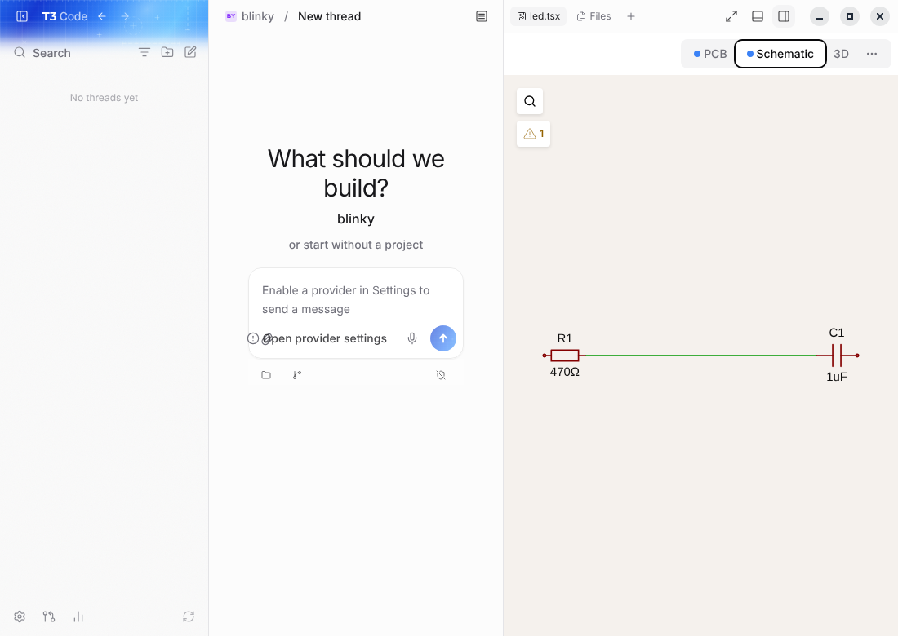

# tscircuit desktop

A desktop app for designing electronics with [tscircuit](https://github.com/tscircuit/tscircuit) and AI: chat with a coding agent on the left, a live circuit preview (PCB, schematic, 3D) on the right.



It is [T3 Code](https://github.com/pingdotgg/t3code) plus a small set of tscircuit changes. T3 Code provides the app: the chat, the model selector, and sign-in through the agents you already use (Claude Code, Codex and others). This repo adds the tscircuit parts.

## This repo is a diff, not a fork

T3 Code lands around 180 commits a day, so this repo does not carry a copy of it. It holds only what tscircuit changes, and rebuilds the full app from that:

```
upstream.json   which T3 Code commit we build on
overlay/        files that exist only here, laid out as they sit in T3 Code
patches/        one patch per T3 Code file we change, each with a note saying why
scripts/        setup, export, bump
.t3code/        the generated app: T3 Code + overlay + patches (not committed)
```

Everything tscircuit-specific is visible in `overlay/` and `patches/`. Keep patches small: put new code in `overlay/` and use a patch only for the line or two that hooks it in. Small hooks are what keep upstream bumps painless.

## Run it

You need the Node version T3 Code pins (currently 26.12.1; `setup` tells you if yours differs) and pnpm. On Linux the desktop build also needs `libsecret-1-dev`.

```sh
npm run setup   # fetch T3 Code at the pin, apply overlay + patches, install
npm run dev     # start the desktop app
```

Then, in the app:

1. Add a project folder that contains a tscircuit project.
2. Connect an agent under **Settings → Providers**. T3 Code drives the agent CLIs on your machine, so you sign in to Claude Code or Codex (ChatGPT) the way those tools normally do.
3. Open the right panel and pick **Circuit** (or press `C` in the panel's "+" menu). The tab renders the project's entry file with RunFrame: PCB, schematic and 3D.
4. Open any `.tsx` file, from the Files tab or a link in the chat, and the Circuit tab switches to that file. The tab is named after the file it shows.

The Circuit tab reads the project's files directly, so there is no dev server to start and no address bar. It re-renders when the agent finishes an edit, when you save a file, and when the window regains focus.

For better results, give the agent tscircuit's reference docs: run `npx skills add tscircuit/skill` in the project.

## Change the app

```sh
npm run setup            # once, or after pulling
# ...edit files inside .t3code/ and try them with `npm run dev`...
npm run export           # save your work back to overlay/ and patches/
```

`export` sorts your changes: files that do not exist upstream go to `overlay/`, and each upstream file you edited gets a patch in `patches/`. A new patch starts with a TODO line; replace it with a sentence on why tscircuit desktop needs the change. Then commit `overlay/` and `patches/`.

`setup` rebuilds `.t3code/` from scratch, so it refuses to run while the checkout holds work you have not exported. Use `npm run setup -- --force` to throw that work away.

Files in `overlay/` live inside T3 Code's tree and follow its lint and format rules. Check them with T3 Code's own tools, for example `npm run t3 -- --dir apps/web vp lint src/tscircuit`.

| Command | What it does |
| --- | --- |
| `npm run setup` | Build `.t3code/` from the pin, overlay and patches, and install dependencies |
| `npm run export` | Save changes in `.t3code/` to `overlay/` and `patches/` |
| `npm run export:check` | Fail if `overlay/` and `patches/` are out of date, or a patch lacks its note |
| `npm run bump` | Move to the newest T3 Code commit and re-apply our changes |
| `npm run dev` | Start the desktop app |
| `npm run build` | Build the desktop app |
| `npm run t3 -- <command>` | Run any command inside `.t3code/`, with T3 Code's `vp` on the PATH |
| `npm run check:app` | Typecheck, lint and test the parts of T3 Code we touch, and run its unused-code check |
| `npm test` | Test the setup, export and bump scripts |

## Follow upstream

```sh
npm run bump             # or: npm run bump -- <commit>
```

`bump` moves `upstream.json` to the tip of T3 Code's `main`, rebuilds, and rewrites the patches against the new code. It prints a link to what upstream changed. Patches are applied as three-way merges, so upstream edits elsewhere in a patched file merge on their own.

When upstream rewrites the same lines a patch touches, `bump` stops and names the file. Open it in `.t3code/`, resolve the conflict markers as you would in any merge, and run `npm run export`.

The **Bump T3 Code** workflow does this daily and opens a pull request when everything still applies and `npm run check:app` passes. It needs the repository setting that lets GitHub Actions create pull requests.

## What tscircuit desktop changes today

| Change | Where |
| --- | --- |
| A **Circuit** tab in the right panel that renders a tscircuit file with RunFrame | `overlay/apps/web/src/tscircuit/` |
| Opening a `.tsx` file shows it in the Circuit tab | `circuitSurface.ts` in that folder, called from `patches/apps__web__src__rightPanelStore.ts.patch` |
| Circuit appears in the panel's launcher and "+" menu, and can be reopened after closing | The other four patches |

That is six new files and five patches that add about 40 lines to T3 Code's own files. The tab is a right-panel tab like Diff or Files, so it gets the panel's layout, shortcuts and persistence without extra code.

How the tab works: it reads the project's source files through T3 Code's own file API, picks the file to render (the one you opened, else `mainEntrypoint` from `tscircuit.config.json`, else `index.tsx` and similar), and hands both to RunFrame's hosted viewer in a frame, with RunFrame's file menu and run button turned off.

## Known gaps

- **Still branded T3 Code.** Name, icons and update feed are upstream's. T3 Code's MIT license covers its code, not its name and logo, so a build you distribute needs its own branding first.
- **The viewer needs internet.** RunFrame is loaded from `runframe.tscircuit.com` (about 34 MB the first time) and is not bundled into the app. Bundling it was tried in an earlier prototype and clashed with the host app's dependencies and styles.
- **`.tsx` files open in the Circuit tab, not the source viewer.** That includes `.tsx` files that are not circuits. A link to a specific line still opens the source.
- **Imports from npm packages are untested.** The viewer gets the project's own source files, not `node_modules`, and resolves packages itself.
- **Large projects are capped.** The tab reads up to 200 source files or 2 MB and says so when it leaves files out. Projects over 40 files refresh on agent edits and window focus only, not on every save.
- **Not yet tried with a real agent turn.** Switching files and live refresh were tested by hand; no signed-in agent was available where this was built.
- **The PCB tab needs WebGPU**, which was unavailable where this was built. The schematic tab rendered there.
- **The bump workflow has not run on GitHub yet.**

Background on these choices is in [docs/research.md](docs/research.md).

## License

The files in this repo are MIT licensed, © tscircuit. T3 Code is MIT licensed, © T3 Tools Inc.; it is downloaded by `npm run setup` and is not redistributed here, apart from the few context lines inside `patches/`.
