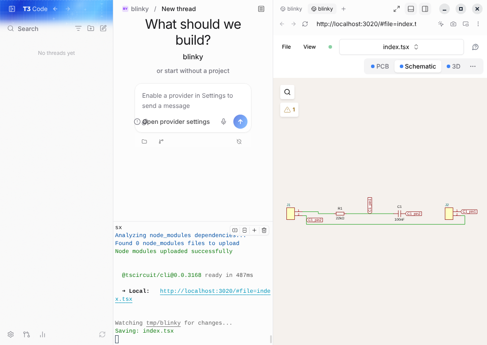

# tscircuit desktop

A desktop app for designing electronics with [tscircuit](https://github.com/tscircuit/tscircuit) and AI: chat with a coding agent on the left, a live circuit preview (PCB, schematic, 3D) on the right.



It is built on [T3 Code](https://github.com/pingdotgg/t3code), which provides the chat, the model selector, and sign-in through the agents you already use (Claude Code, Codex and others). This repo renames it, gives it tscircuit's icon, and adds the tscircuit parts.

## This repo is a diff, not a fork

T3 Code lands around 180 commits a day, so this repo does not carry a copy of it. It holds only what tscircuit changes, and rebuilds the full app from that:

```
upstream.json   which T3 Code commit we build on
skill.json      which agent skill to download and bundle into the app
viewer.json     which tscircuit and manifold-3d to bundle as the circuit viewer
renames.json    find-and-replace rules: T3 Code's name, IDs and folders become ours
overlay/        files that exist only here, and icons that replace T3 Code's
patches/        one patch per T3 Code file we change, each with a note saying why
branding/       the icon source and the script that generates the icon files
scripts/        setup, export, bump
.t3code/        the generated app: T3 Code + renames + overlay + patches (not committed)
```

Everything tscircuit-specific is visible in `renames.json`, `overlay/` and `patches/`. Keep patches small: put new code in `overlay/` and use a patch only for the line or two that hooks it in. Small hooks are what keep upstream bumps painless.

### Renames

T3 Code writes its name in about 1,200 places. Carrying those as patches would conflict on every bump, so they are rules in `renames.json` instead: `setup` re-runs them on each new upstream commit, which also covers text upstream adds later. Each rule says why it exists. Patches are then measured against the renamed code, so a rename never shows up as a patch.

`setup` stops if a rule no longer matches anything, because that means upstream reworded the thing the rule was for.

## Run it

You need the Node version T3 Code pins (currently 26.12.1; `setup` tells you if yours differs) and pnpm. On Linux the desktop build also needs `libsecret-1-dev`.

```sh
npm run setup   # fetch T3 Code at the pin, apply overlay + patches, install
npm run dev     # start the desktop app
```

Then, in the app:

1. Add a project folder that contains a tscircuit project.
2. Connect an agent under **Settings → Providers**. T3 Code drives the agent CLIs on your machine, so you sign in to Claude Code or Codex (ChatGPT) the way those tools normally do.
3. Open the right panel and pick **Circuit** (or press `C` in the panel's "+" menu). The tab shows the project's entry file, with a row of views: Source, PCB, Schematic, 3D, System and BOM, and Drawings when the design has drawings.
4. Open any `.tsx` file, from the Files tab or a link in the chat, and the Circuit tab switches to that file. The tab is named after the file it shows.
5. A view the file has nothing for is greyed out. Click it for a short example of what to add, and a button that puts the request in your prompt.

The Circuit tab reads the project's files directly, so there is no dev server to start and no address bar. It re-renders when the agent finishes an edit, when you save a file, and when the window regains focus.

### Install it on a Mac

Download the newest `.dmg` from [Releases](https://github.com/tscircuit/tscircuit-desktop/releases), open it, and drag tscircuit desktop to Applications. Builds are for Apple Silicon.

The builds are signed with tscircuit's Apple Developer ID and notarized by Apple.

### Install it on Windows

Download and run the Windows x64 `.exe` installer from [Releases](https://github.com/tscircuit/tscircuit-desktop/releases). The installer, app, and uninstaller are signed by tscircuit Inc.

## Review a pull request

Open the **Preview** link in Vercel's comment on the pull request to try the app in a browser. Each browser gets an isolated Vercel Sandbox with a voltage divider project and tscircuit simulation tools. Replay is ready to use. For a live model, go to **Settings → Providers → Add provider → Codex → Continue with ChatGPT**. If the sign-in tab stops at localhost, paste its address into the sign-in form in the preview and click **Connect**.

The **Check** workflow also attaches full app screenshots of the sample circuit and Add chip flow as `ui-preview` in the run summary. To run the browser preview locally after setup, use `npm run preview`.

Connect the repository to a dedicated Vercel project with OIDC and GitHub pull request comments enabled. Set `main` as its production branch and select **Only build preview** in **Ignored Build Step**. Vercel builds preview branches when they receive a push and posts the deployment link on the pull request. Fork pull requests may require approval in Vercel.

## Change the app

```sh
npm run setup            # once, or after pulling
# ...edit files inside .t3code/ and try them with `npm run dev`...
npm run export           # save your work back to overlay/ and patches/
```

`export` sorts your changes: files that do not exist upstream go to `overlay/`, so do upstream images you replaced, and each upstream text file you edited gets a patch in `patches/`. A new patch starts with a TODO line; replace it with a sentence on why tscircuit desktop needs the change. Then commit `overlay/` and `patches/`.

`setup` rebuilds `.t3code/` from scratch, so it refuses to run while the checkout holds work you have not exported. Use `npm run setup -- --force` to throw that work away.

Files in `overlay/` live inside T3 Code's tree and follow its lint and format rules. Check them with T3 Code's own tools, for example `npm run t3 -- --dir apps/web vp lint src/tscircuit`.

| Command | What it does |
| --- | --- |
| `npm run setup` | Build `.t3code/` from the pin, overlay and patches, and install dependencies |
| `npm run export` | Save changes in `.t3code/` to `overlay/` and `patches/` |
| `npm run export:check` | Fail if `overlay/` and `patches/` are out of date, or a patch lacks its note |
| `npm run bump` | Move to the newest T3 Code commit and re-apply our changes |
| `npm run dev` | Start the desktop app |
| `npm run build` | Build the desktop app |
| `npm run t3 -- <command>` | Run any command inside `.t3code/`, with T3 Code's `vp` on the PATH |
| `npm run check:app` | Typecheck, lint and test the parts of T3 Code we touch, and run its unused-code check |
| `npm test` | Test the setup, export and bump scripts |

## Follow upstream

```sh
npm run bump             # or: npm run bump -- <commit>
```

`bump` moves `upstream.json` to the tip of T3 Code's `main`, rebuilds, and rewrites the patches against the new code. It prints a link to what upstream changed. Patches are applied as three-way merges, so upstream edits elsewhere in a patched file merge on their own.

When upstream rewrites the same lines a patch touches, `bump` stops and names the file. Open it in `.t3code/`, resolve the conflict markers as you would in any merge, and run `npm run export`.

The **Bump T3 Code** workflow does this daily and opens a pull request when everything still applies and `npm run check:app` passes. It needs the repository setting that lets GitHub Actions create pull requests.

## What tscircuit desktop changes today

| Change | Where |
| --- | --- |
| The app is called tscircuit desktop: window titles, dialogs, error messages, agent prompts | `renames.json` |
| No Beta or Nightly label on the name; only `npm run dev` shows "(Dev)" | `renames.json`, three patches |
| Its own app ID, link scheme (`tscircuit-desktop://`) and data folders (`~/.tscircuit-desktop`), so it can sit beside an installed T3 Code without sharing its data or taking its links | `renames.json` |
| tscircuit's icon for the app, the window and the favicon; "tscircuit desktop" in the sidebar | `overlay/assets/`, `overlay/apps/web/public/`, `branding/`, three patches |
| Usage analytics off by default, and the screens that describe them corrected | Four patches |
| No import of settings from an installed T3 Code's older profile folders | Two patches |
| Download, release and bug-report links point at this repository | `renames.json` |
| The [tscircuit skill](https://github.com/tscircuit/skill) is bundled and installed for agents when the app starts | `skill.json`, `overlay/apps/server/src/tscircuit/`, one patch |
| A **Circuit** tab in the right panel that renders a tscircuit file with RunFrame | `overlay/apps/web/src/tscircuit/` |
| RunFrame, its eval worker and manifold-3d are bundled into the app and served on a host of their own | `viewer.json`, `scripts/lib/viewer.ts`, `overlay/apps/web/public/tscircuit-viewer/`, `overlay/apps/desktop/src/tscircuit/`, one patch |
| The Circuit tab's own row of views (Source, PCB, Schematic, 3D, System, BOM, and Drawings when there are any) in place of RunFrame's header; views with nothing to show are greyed out and explain how to fill them | `circuitViews.ts`, `CircuitPanel.tsx`, `CircuitViewHelpDialog.tsx` in that folder |
| Opening a `.tsx` file shows it in the Circuit tab | `circuitSurface.ts` in that folder, called from `patches/apps__web__src__rightPanelStore.ts.patch` |
| Circuit appears in the panel's launcher and "+" menu, and can be reopened after closing | Four patches |

How the Circuit tab works: it reads the project's source files through T3 Code's own file API, picks the file to render (the one you opened, else `mainEntrypoint` from `tscircuit.config.json`, else `index.tsx` and similar), and hands both to RunFrame, which runs in a frame from the app's own files.

The row of views is the app's, not RunFrame's. The app tells RunFrame which view to draw and to hide its own header, and RunFrame reports back what the rendered circuit contains (how many elements of each type) and whether the run failed. From that the app greys out views with nothing in them, moves off an empty view when a file is first opened, and shows RunFrame's error list when a file does not run. Source is drawn by the app from the same file text, with T3 Code's read-only viewer.

To change the icon, edit `branding/app-icon.svg` and run `sh branding/make-icons.sh`, then `npm run export`.

### CircuitHub quotes

Open **Order → CircuitHub** in the desktop app and sign in using your system browser. Enter the workspace slug from your CircuitHub workspace URL, board quantities, and the board's export classification (for example, EAR99, if applicable). An existing project ID adds a revision to that project instead of creating another project.

**Get quote** uploads the completed board as a KiCad project, including its schematic symbols. The panel shows import progress, service offers, unresolved parts and whether pricing is preliminary. **Refresh prices** requests fresh prices for the uploaded revision; **Quote new revision** uploads the current board. Quotes from an earlier board version stay labelled as such. **Review in CircuitHub** opens checkout in the browser; requesting a quote never orders a board.

The desktop process holds the login token and uses the OS keychain to encrypt the saved session. It keeps the session in memory when secure storage is unavailable. **Disconnect** clears the saved session. CircuitHub tokens are never sent to the circuit viewer. Browser-only clients can open CircuitHub but cannot connect an account through this native integration.

### The bundled skill

`setup` downloads the newest [tscircuit skill](https://github.com/tscircuit/skill) and packs it into the app, so every build carries the skill as it was on the day it was built. It is generated, not committed.

When the app starts it copies the skill to `~/.agents/skills/tscircuit` (read by Codex and most other agents) and `~/.claude/skills/tscircuit` (Claude Code). A folder it installed carries a marker file and is replaced when a newer build brings a newer skill. A folder of that name without the marker is your own copy, for example from `npx skills add tscircuit/skill`, and is left alone.

## Releases and automatic updates

Every push to `main` builds the app and publishes a GitHub release one patch number above the release before it: `v0.1.61`, then `v0.1.62`. The minor number never moves by itself: running the Release workflow by hand on `main` with `bump` set to `minor` publishes the first release of the next minor version, `v0.2.0`. Changes that only touch documentation do not release.

The Mac app is signed with tscircuit's Apple Developer ID and notarized by Apple. T3 Code's packaging script only signs the Mac app when its own passkey sign-in is configured (a provisioning profile and a sign-in domain that tscircuit desktop does not use), so the release workflow signs the finished app itself, with `scripts/sign-macos.sh`.

Windows releases use the same Azure Artifact Signing profile as [tscircuit-standalone](https://github.com/tscircuit/tscircuit-standalone/blob/main/.github/workflows/sign-windows.yml). The `windows-signing` GitHub environment is restricted to `main`. Its six `AZURE_*` variables configure GitHub OIDC login and the certificate profile. The Windows job installs the package and checks the timestamped Authenticode signatures before the release is published. Windows pull requests build unsigned installers for testing.

**The app updates itself** from this repository's releases. Each release carries the files the updater reads, `latest-mac.yml`, `latest.yml` and `latest-linux.yml`; the release workflow writes the Mac one again after signing, since signing changes the zip. Pull request builds never update themselves. Copies installed before this was turned on say updates are unavailable, and need one newer release installed by hand.

## Beside T3 Code

tscircuit desktop is meant to be installed on a machine that also has T3 Code. Each of these is the app's own, so neither app reads, overwrites or removes the other's:

| | tscircuit desktop | T3 Code |
| --- | --- | --- |
| Command | `tscircuit-desktop` | `t3` |
| Data folder | `~/.tscircuit-desktop` | `~/.t3` |
| Environment variables | `TSCIRCUIT_DESKTOP_…` | `T3CODE_…` |
| App ID and link scheme | `com.tscircuit.desktop`, `tscircuit-desktop://` | `com.t3tools.t3code`, `t3code://` |
| Project file | `tscircuit-desktop.json` | `t3.json` |
| Branches it creates | `tscircuit/…` | `t3/…`, `t3code/…` |
| Hidden git refs (checkpoints) | `refs/tscircuit-desktop/…` | `refs/t3/…`, `refs/t3code/…` |
| Compile cache folder | `tscircuit-desktop` | `t3code` |
| Background service | `com.tscircuit.desktop.service`, `tscircuit-desktop.service` | `t3code` |

Builds up to 0.1.3 linked the command as `t3`. The first launch of a newer build removes that link if it is this app's, leaves T3 Code's `t3` alone, and links `tscircuit-desktop` in its place. Checkpoints that 0.1.3 made stay under `refs/t3/` in the project, so threads from that build cannot be rolled back to them.

Still shared, or not yet separate:

- **The agents' own data.** Claude Code, Codex and the others keep their sign-in and history in their own folders, whichever app starts them.
- **Per-branch git settings.** Both apps record a branch's base and pull request under the same `branch.<name>.t3-…` keys in a repository's git config.
- **Remote machines.** Connecting to another computer over SSH installs T3's server there, which uses T3 Code's names on that machine.

## Privacy

This section is where the app's privacy link points. tscircuit desktop has no privacy policy of its own yet, and T3 Code's does not cover this build.

- **Usage analytics are off.** T3 Code sends anonymous usage data to its own analytics service. This build does not, unless you start it with `TSCIRCUIT_DESKTOP_TELEMETRY_ENABLED=true`, in which case the data goes to T3 Code's service, not to tscircuit.
- **Your agent talks to its provider.** Prompts and code go to whichever agent you connect (Claude Code, Codex and others), under that provider's terms.
- **The Circuit tab renders with a copy of RunFrame inside the app.** Nothing is loaded from `runframe.tscircuit.com` or a CDN to draw a circuit, and RunFrame's own usage analytics are turned off. Rendering a circuit can still reach the network: tscircuit looks up parts for the components you use (`jlcsearch.tscircuit.com`, `easyeda.com`), fetches packages your circuit imports, and the 3D view fetches fonts and STEP-import code from a CDN when a board needs them.
- **The list of available models is fetched from T3 Code's GitHub repository.**

This list covers what was checked while building the rename. It is not a full audit of what T3 Code's code contacts.

## Known gaps

- **Some T3 names remain on purpose.** T3 Connect and T3 Chat keep their names because they are T3's own services, agents still see the app's tools under the name `t3-code`, and `npx t3` in the app's text means T3's package on npm. See "Beside T3 Code" for what is separate.
- **Apple Silicon, Windows x64 and Linux x64 only.** The Windows installer ships the native runtime without the optional WSL runtime archive.
- **The bundled skill is only as new as the build.** It is refreshed when a release is built, not while the app runs.
- **"Report a problem" still files to T3 Code.** The built-in triage agent is written to search and open issues in T3 Code's repository. It needs rewriting for this repository before the app is given to users.
- **The server's own updater still looks at T3 Code's releases.** It applies to servers started with `tscircuit-desktop` from a terminal, not to the desktop app.
- **A few of T3 Code's own tests fail after the renames.** They use the old name as test data or check an upstream link. `npm run check:app` does not run them; see `docs/research.md` for the list.
- **The viewer is the app's copy, not the project's.** A project that installs its own `tscircuit` in `node_modules` is still rendered with the version the app was built with. The viewer adds about 64 MB to the app.
- **The Source view is read-only.** `.tsx` files open in the Circuit tab, where Source shows the text but does not edit it. A link to a specific line still opens T3 Code's editor. `.tsx` files that are not circuits open on Source, with the other views greyed out or an error listed.
- **No PCB view when the app is used from a browser.** The PCB view draws with WebGPU in a worker, and a worker in a frame without an origin gets no WebGPU. The desktop app is not affected. Schematic, 3D, System and BOM work in both.
- **Imports from npm packages are untested.** The viewer gets the project's own source files, not `node_modules`, and resolves packages itself.
- **Large projects are capped.** The tab reads up to 200 source files or 2 MB and says so when it leaves files out. Projects over 40 files refresh on agent edits and window focus only, not on every save.
- **Not yet tried with a real agent turn.** Switching files and live refresh were tested by hand; no signed-in agent was available where this was built.
- **The PCB tab needs WebGPU**, which was unavailable where this was built. The schematic tab rendered there.
- **The bump workflow has not run on GitHub yet.**

Background on these choices is in [docs/research.md](docs/research.md).

## License

The files in this repo are MIT licensed, © tscircuit. T3 Code is MIT licensed, © T3 Tools Inc.; it is downloaded by `npm run setup` and is not redistributed here, apart from the few context lines inside `patches/`. A build you give to others contains T3 Code's code, so it must ship with T3 Code's license and copyright notice.
