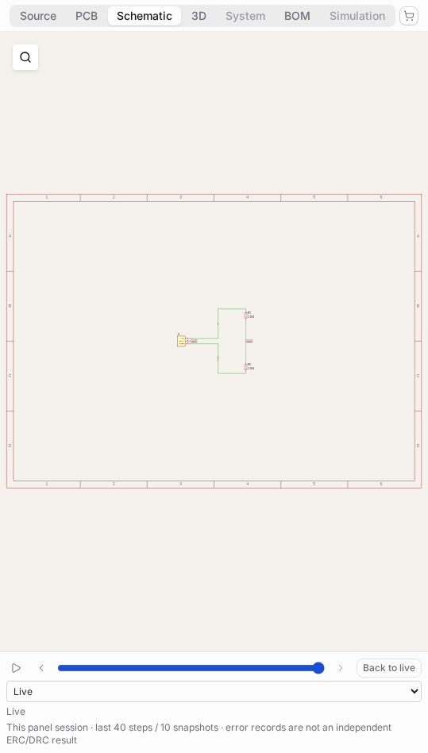
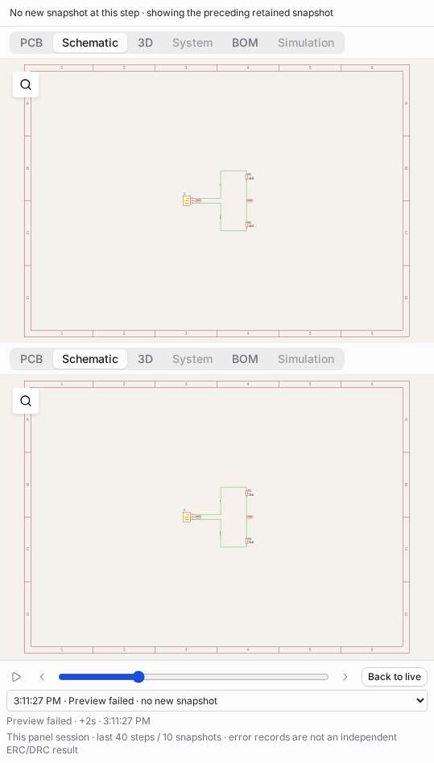
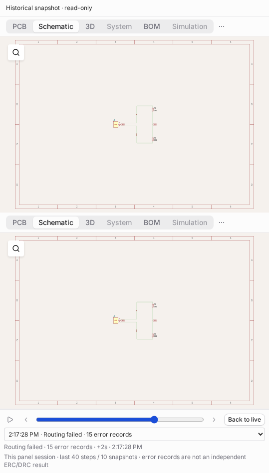

# Design playback

The Circuit panel records the preview attempts it observes while open. Use the discrete slider (including arrow keys), step picker, previous/next buttons, or play/pause; **Back to live** returns to the current workspace.

A native source attempt is identified at the existing eval-worker boundary. The frame observes routing start/end/error, explicit rerouting flags, and the native source/placement/PCB rule-check phases. After the attempt settles it retains its Circuit JSON, including error records and partial output when available. A compile failure without output gets a marker with **no new snapshot**; seeking it shows the preceding retained artifact with that distinction visible. An explicit `pcb_autorouting_error` in output is a routing-failure step. “0 error records” describes the recorded output, not a separately executed ERC/DRC test.

Saved CLI builds from `.tscircuit-build-history` and the latest `dist/<entry>/circuit.json` are also available in the timeline, including builds saved before this panel opened. Archive dates are the original build times; the latest disk output is marked when its build time is unavailable. Only the selected artifact is read. These entries survive reopening the project because the CLI stores them on disk. The CLI saves build history by default; older overwritten builds cannot be recovered when no artifact was retained. Historical artifacts retain their original identity: they are never checked against the current source hash when seeking. Both historical split panes receive the same frozen JSON; Source, Order, and source-building/report actions are absent from historical panes. Live frames remain mounted and refresh independently. Seeking and switching historical tabs send JSON or view props, never TSX evaluation requests.

Preview events are local to this panel session, environment, workspace, thread, and entrypoint. Closing the panel or restarting discards those session events, while saved CLI builds remain available. Preview retention is bounded to 40 steps, 10 snapshots, and 20 MiB of UTF-8 artifact text. Saved builds are listed separately from that memory budget and loaded on selection, with the same per-artifact size limit. Evicted selections stay explicitly unavailable instead of silently switching to a live orderable design. No command output, prompts, terminal logs, or source-file copies are added to history; stored Circuit JSON retains its normal artifact metadata.

## Saved builds after reopening

[Watch the actual saved-builds recording](saved-builds.mp4) and [its timestamped proof](saved-builds-proof.json). Three native CLI builds used 10k, 4.7k, and 2.2k resistors; the CLI archived the first two automatically. With live source changed to 1k, both historical panes rendered each saved artifact. Source-evaluation calls and worker starts stayed **2 → 2** while seeking. A full app reload rediscovered both archives and rendered the original 10k build again without evaluating source.

| Live source: 1k | Saved 10k build after app reload |
| --- | --- |
|  |  |

To reproduce, run `tsci build` three times with those resistor values, then change the live source without rebuilding. Reopen the Circuit panel and select the dated **Saved build** entries. These are the CLI's existing artifacts, not builds generated by seeking.

## Reproduce the native preview proof

1. `npm run setup`, then `npm run preview`. Open the seeded **Circuit review** thread and its **Circuit → Schematic** surface.
2. Use the generated Voltage divider project (the preview runner prints its sandbox base directory). Its source is the same native TSX as `scripts/fixtures/review-preview/index.tsx`. Changes below are real file edits; focus the app to refresh after each edit.
3. Let the baseline finish. Replace the entrypoint with `export default function InvalidAttempt() { throw new Error("Playback proof: invalid TSX attempt"); }`. This produces a real failure with no new artifact.
4. Restore the baseline and change its resistor values from `10k` to `4.7k`. Let the corrected attempt finish.
5. Add `<keepout shape="rect" width="18mm" height="12mm" layers={["top", "bottom"]} />` directly inside the board. This actually produces placement/autorouting errors. Remove it and change the resistor values to `2.2k`; the next native run finishes with zero error records.
6. Seek the failed attempt and the routing-error artifact. Switch Schematic/PCB without moving the playhead, try the two-pane split and play/pause, then return live. Historical panes show the retained artifact even though live source now differs.

The proof uses the repository's standard review-preview app and real worker output. The stock Replay chat alongside it is unrelated sample conversation; it supplies none of the playback states. `native-proof.json` records observed timestamps, artifact hashes, error counts, and measured evaluation-call counts. Screenshots show actual panel states.

## Captured states

[Watch the actual native panel recording](native-playback.mp4). It preserves the original timing and is cropped to the Circuit panel.

The final native run observed five source attempts and five terminal results. After opening the second live pane, evaluation RPC counts stayed **6 → 6** through two-pane history, Schematic/PCB tab changes, play/pause, and returning live. See [the timestamped machine-readable proof](native-proof.json).

| Current live design after correction | Failed step with no new snapshot | Historical routing-error artifact |
| --- | --- | --- |
|  |  |  |

## Coverage and limits

Unit tests cover retention limits, UTF-8 artifact budgets, repeated events, failed output versus missing output, superseded worker results, remote proxy calls, and the preview-event parser. The existing Circuit panel browser suite covers stale preview IDs, workspace isolation, split-frame synchronization, and JSON-only seeking without resending live source. The native proof additionally counts actual worker `executeWithFsMap` RPCs while scrubbing, switching tabs, playing, and returning live.

This includes saved CLI build artifacts and observes native preview events, rather than arbitrary agent command activity. CLI failures without saved JSON, internal solver retries without a recognized event, and datasheet producer attempt-history files are not imported. No CLI, Core, autorouter, or Circuit JSON contract changes are included. Playback does not restore source files and is not a complete audit trail. Historical frames initially fit their own viewport.

Validation here used the generated Web entrypoint and native TSX worker. A test-only preload returned no network interfaces when this cloud sandbox denied interface enumeration, avoiding an unrelated upstream server failure; it did not change circuit execution. Desktop's isolated viewer-host routing is covered by its tests. Packaged Electron on macOS/Windows and a signed-in agent turn were not exercised. The browser's existing opaque-origin WebGPU restriction prevents verifying the PCB bitmap; tab selection and immutable snapshot selection are verified.
