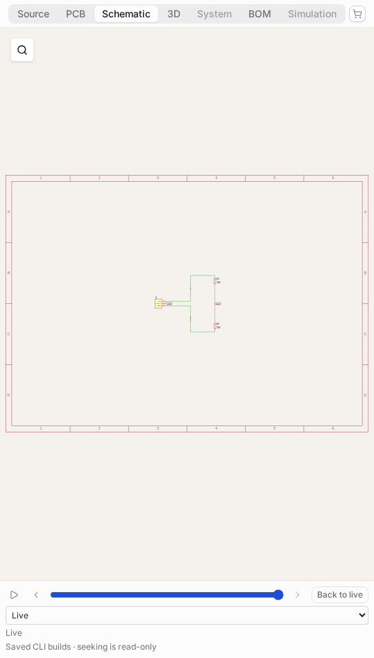
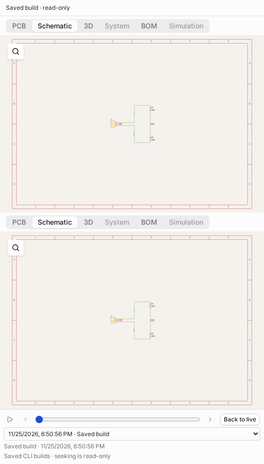

# Saved-build playback

Open the Circuit panel's **Build history** to view old builds from the CLI's `.tscircuit-build-history` and the latest `dist/<entry>/circuit.json`. The picker, slider, previous/next buttons, and play/pause move between saved builds. **Back to live** returns to the current design.

History survives reopening because the artifacts are already on disk. Dates come from the CLI archive names; the latest output is marked when its build time is unavailable. Overwritten builds cannot be recovered unless an artifact was saved. Failed commands without a Circuit JSON artifact do not create a build entry.

Each selection loads one saved Circuit JSON, with a 20 MiB UTF-8 limit, into both historical panes. Seeking does not evaluate source or restore files. Historical panes omit source, ordering, and source-building actions. The current live view remains separate. Missing or invalid artifacts show an unavailable state; late reads from another selection or workspace are discarded.

## Saved builds after reopening

[Watch the actual saved-builds recording](saved-builds.mp4) and [its timestamped proof](saved-builds-proof.json). Three native CLI builds used 10k, 4.7k, and 2.2k resistors; the CLI archived the first two automatically. With live source changed to 1k, both historical panes rendered each saved artifact. Source-evaluation calls and worker starts stayed **2 → 2** while seeking. A full app reload rediscovered both archives and rendered the original 10k build again without evaluating source.

| Live source: 1k | Saved 10k build after app reload |
| --- | --- |
|  |  |

To reproduce, run `tsci build` three times with those resistor values, then change the live source without rebuilding. Reopen the Circuit panel and select the dated **Saved build** entries. These are the CLI's existing artifacts, not builds generated by seeking.

## Validation and limits

The focused browser test covers split-pane JSON loading, discarded late reads, workspace isolation, and returning live without resending source. Unit coverage checks archive discovery and entrypoint isolation, plus invalid and oversized artifacts. The native demo uses real CLI outputs and measures actual worker starts and source-evaluation calls.

Validation uses the generated Web app's Circuit entrypoint. Packaged Electron and a signed-in agent turn were not exercised. The browser's existing opaque-origin WebGPU restriction prevents verifying the PCB bitmap; the schematic and selected JSON are verified. No CLI, Core, autorouter, or Circuit JSON contract changes are included.
